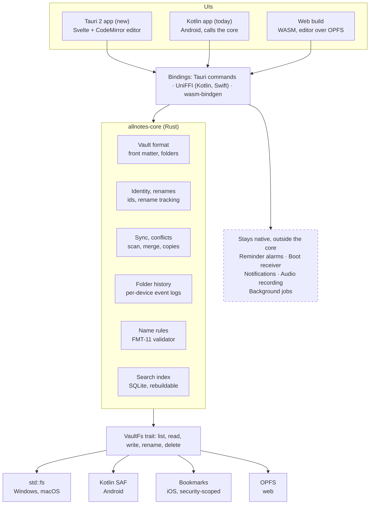
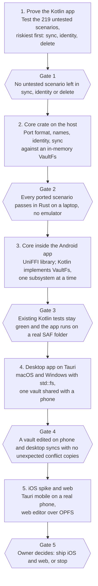

# AllNotes: Rust migration research

As of 2026-11-12. Repository figures were counted from this repository on that date; technology claims come from
search-result summaries (see [Sources](#sources)) and should be checked before relying on a detail.

## Summary and recommendation

Build one Rust core and one web-technology UI, ship the UI through Tauri 2 to Windows, macOS, iOS and Android, and keep
the current Kotlin app running until the new one matches it. For a single developer this means one core and one UI
codebase to maintain instead of four.

- **Core in Rust:** a `allnotes-core` crate owns the vault format, identity and rename tracking, name validation, the
  scan and sync engine, conflicts and folder history. These are the parts that lose data if two implementations drift.
- **Android first, as a library:** the Rust core ships inside the existing app through UniFFI bindings, replacing one
  subsystem at a time. The same crate later serves desktop, iOS and web.
- **The spec is the test suite:** 199 requirements and 378 Gherkin scenarios already describe the behavior (219 of them
  still lack an automated test). Porting them to Rust tests comes before porting code.
- **Scope is today's features only:** widgets and per-platform polish are deferred.
- **Main risk:** Tauri's mobile support is its weakest part. If it disappoints, Compose on Android with the same Rust
  core is the fallback.

## What AllNotes is today

AllNotes is a notes app whose storage is a plain folder of Markdown files, and about 24,000 lines of Kotlin implement
it. The part worth porting first is the one that decides whether notes survive: the folder-sync subsystem is roughly
8,000 lines and its rules live in the spec, not only in the code.

**Features in scope for a port** (everything the app does today):

- Notes as Markdown or plain text, with checklists, colours, pinning, archiving, hiding and a bin with auto-purge.
- Notebooks as folders, tags, search and sorting.
- Attachments, photos, audio recording and a media viewer.
- Reminders stored in the note file and rescheduled after a sync.
- Folder sync across devices with identity, rename tracking, conflict copies, per-device history logs and crash-safe
  writes.
- Zip backup and restore, Settings, share-in, launcher shortcuts and one home-screen widget.

**What not to port blindly.** The review of the code found behavior that looks unintended, and each item needs an owner
decision first: a checklist converted to text and back loses its check marks, removing an audio attachment leaves its
link in the note, hidden pinned notes appear on the widget, and archived notes still fire reminders. The full list is
in [the audit](../audits/2026-11-12-undocumented-features-review.md).

**Spec as conformance suite.**

| Measure | Today |
| --- | --- |
| Requirements | 199 |
| Gherkin scenarios | 378 |
| Scenarios proven by a named test | 159 |
| Scenarios with no test yet (`@gap`) | 219 |
| Kotlin test code | about 20,000 lines |

The 159 proven scenarios port straight into Rust tests. The 219 gaps need a test written first, in either language,
before they count as a contract.

## Options compared

Tauri 2 with a shared Rust core is the only option that gives one developer all five targets from one UI codebase, and
its mobile side is the part to prove early. The other three each trade that away for maturity on a subset of platforms.

| Option | Targets | Strength | Weakness | Fit for one developer |
| --- | --- | --- | --- | --- |
| [Tauri 2](https://v2.tauri.app/blog/tauri-20/) + web UI + Rust core | Windows, macOS, Linux, iOS, Android; web through WASM | One UI codebase; Rust is the native backend; plugins can call Kotlin and Swift | Not all official plugins support mobile; editor and keyboard behavior is WebView-grade | Best, if mobile holds up |
| Native UIs (SwiftUI, Compose, WinUI, web) + Rust core | All | Best platform feel and integration (SAF, file providers, share sheets) | Four UI codebases to build and maintain | Poor: four times the UI work |
| [Compose Multiplatform](https://kotlinlang.org/docs/multiplatform/supported-platforms.html) + Rust core | Android, iOS, desktop, web | Reuses the current Kotlin and Compose code | iOS is stable, but the web target is still beta; Rust becomes a bridge, not the app | Good for Android, iOS, desktop; weak for web |
| Pure-Rust UI (Dioxus, Slint, egui) | All | One language | My assessment, not sourced: text editing, input methods and accessibility are less mature than in a browser engine | Risky for a note editor |

**What the sources say.** Tauri 2 added iOS and Android in its
[2.0 stable release](https://v2.tauri.app/blog/tauri-20/), with mobile templates, device hot reload, and plugins that
call Swift on iOS and Kotlin or Java on Android. Coverage of the release notes that not every official plugin works on
mobile, and I did not find a current compatibility list. Compose Multiplatform's iOS target is stable (since 1.8) and
its web target on Wasm is in beta (since 1.9), with a stable web release targeted for 2026 on the
[JetBrains stability page](https://kotlinlang.org/docs/multiplatform/supported-platforms.html).

**Recommendation.** Take Tauri 2 for desktop and web first, where it is strongest, and treat mobile as a spike with an
explicit fallback: keep the Kotlin app on Android and call the Rust core through UniFFI.

## Target architecture

Every UI talks to one Rust crate, and that crate reaches storage only through a `VaultFs` trait, so the sync rules are
written once and each platform supplies only its file access.

The Kotlin app is the first caller and Tauri and the web build follow. Alarms, the boot receiver, notifications,
recording and background jobs stay in platform code, outside the core. The search index is a cache that can be rebuilt
from the folder, so the notes remain plain files.

## Android integration

Rust ships inside the existing Android app as a native library, and UniFFI generates the Kotlin classes, so the Kotlin
app can adopt the core one subsystem at a time. The Kotlin `SafVaultFs` the app already has maps almost directly onto a
Rust trait implemented on the Kotlin side.

**How it is built.** Rust compiles to the Android targets with the NDK and produces one `.so` per ABI, which Gradle
packages from `jniLibs/`. `cargo-ndk` or the `rust-android-gradle` plugin runs the build from Gradle. UniFFI generates
idiomatic Kotlin from the Rust API; hand-written JNI with the `jni` crate is the alternative, with much more
boilerplate.

**Storage is the design problem.** The notes folder is reached through the Storage Access Framework, so Android gives
the app `content://` URIs, not file paths. UniFFI supports traits that Kotlin implements:
[foreign traits are marked `with_foreign`](https://mozilla.github.io/uniffi-rs/next/types/interfaces.html), and UniFFI
0.27 added async functions on them. The Rust core can therefore call back into Kotlin for list, read, write, rename and
delete, and the existing SAF code stays where it is. Passing raw file descriptors
(`ParcelFileDescriptor.detachFd()`) works for reads and writes but not for listing or renaming.

**Things to plan for.**

- **16 KB pages.** Google requires apps targeting Android 15 (API 35) and higher to support
  [16 KB memory pages](https://developer.android.com/16kb-page-size) on 64-bit devices, which affects native libraries.
  NDK r28 and later
  [align libraries for 16 KB by default](https://android-developers.googleblog.com/2025/07/transition-to-16-kb-page-sizes-android-apps-games-android-studio.html),
  and Android Gradle Plugin 8.5.1 or later aligns uncompressed libraries when packaging. The enforcement date differs
  between sources (November 1, 2025 in Google's blog, February 1, 2027 on a Play Console page), so check the current
  Play policy.
- **Size.** Each ABI adds a library. Ship only `arm64-v8a` and `x86_64` if the app can drop 32-bit devices, and strip
  symbols. I have not measured the size of a AllNotes-sized core.
- **Threads and async.** Keep Rust work off the main thread and expose async calls through UniFFI. Kotlin-side async
  fixes appear in the UniFFI changelog, so pin a version and test it.
- **Crashes.** A panic or fault in Rust shows up as a native crash, so build with symbols and add them to crash
  tracking.
- **Tests.** The core's unit tests run on the host with no emulator, which makes porting the Gherkin scenarios fast.

**Precedent.** Mozilla created UniFFI for Firefox's mobile code, and Rust cores called from Kotlin and Swift are used in
shipping apps; I did not verify the specific products I recalled, so treat that as background, not evidence.

## Platform constraints

The vault folder is the hard part on every platform, because each OS reaches a user-chosen folder differently, and that
is why the core talks to storage through one trait. Only the web row below is sourced; the other rows are my assessment
from platform knowledge and should be checked in the first spike.

| Target | How the notes folder is reached | Reminders and background work | Main gap to close |
| --- | --- | --- | --- |
| Windows, macOS | Direct file paths; a file-watcher crate can replace the Android observer | OS notifications; a tray or login item if background sync is wanted | Case-insensitive volumes and reserved names, already covered by FMT-11 |
| Android | Storage Access Framework URIs through a Kotlin-implemented trait | Exact alarms, boot receiver and WorkManager stay native Kotlin | Plugin or shim code if the UI moves to Tauri |
| iOS | Document picker with security-scoped bookmarks and file coordination | Local notifications; background sync is tightly limited by the OS | Reminders and sync cadence behave differently from Android |
| Web | `showDirectoryPicker()` is Chromium-only; [OPFS](https://web.dev/opfs) works in Chrome 86, Edge 86, Firefox 111 and Safari 15.2 | No background work; reminders need a server or are dropped | No shared-folder sync outside Chromium; treat the web build as an editor over OPFS |

Sources disagree on Firefox and Safari because some pages mix the directory picker with OPFS; the
[feature table](https://web-platform-dx.github.io/web-features-explorer/features/file-system-access) lists a negative
position from Firefox and an opposing one from Safari for the picker.

Two consequences follow. The Android row means the Kotlin reminder, alarm and boot code survives any migration path and
is not rewritten in Rust. The web row means the sync model, which assumes a folder that another tool copies between
devices, does not carry over to a browser, so the web build is a smaller product.

## Phased plan

The plan is five phases in a fixed order, each ending at a gate that must pass before the next starts, so a failed
assumption stops the work early instead of after the UI is built.

The phases carry no durations because I have no basis to estimate one developer's pace. The Tauri mobile spike from the
risk table can run at any point after phase 2, and its result decides whether phase 5 stays on Tauri or falls back to
Compose on Android with the same core.

## Risks and open decisions

The two risks that can change the plan are Tauri on mobile and the untested half of the spec, and both can be tested
cheaply before committing.

| Risk | Why it matters | Mitigation | Verify first |
| --- | --- | --- | --- |
| Tauri mobile is not good enough | Not every official plugin supports mobile; editor and keyboard feel is WebView-grade | Keep Android native and call the core through UniFFI; Compose on Android is the fallback | A one-week spike: CodeMirror editing a note from a SAF folder on a real phone |
| Half the spec is unproven | 219 of 378 scenarios have no automated test, so a port could change behavior unnoticed | Write the missing tests against the Kotlin app first, then port them | Rank the 219 by data-loss risk (sync, identity, delete) and test those first |
| Porting known defects | The audit lists behavior that looks unintended | Decide each item as fix, keep or drop before it enters the core | Owner triage of the audit list |
| Storage differs per platform | SAF, security-scoped bookmarks and OPFS are not file paths | One `VaultFs` trait implemented per platform | A fake in-memory implementation passing the whole sync spec |
| Native Android code remains | Alarms, boot receiver, recording and WorkManager are platform APIs | Leave them in Kotlin; expose only the core | List the Kotlin that stays, so the scope is honest |
| Play policy on native libraries | 16 KB page alignment applies to native code; sources give different deadlines | NDK r28 or later and AGP 8.5.1 or later | Check the current Play Console policy date |

**Owner decisions needed before the rewrite starts.**

- Which audit findings are defects to fix, and which stay as behavior (the list is in
  [the audit](../audits/2026-11-12-undocumented-features-review.md)).
- Whether the app keeps its offline-only promise, since previewing a note with an `https://` image link currently
  fetches it.
- Targets for note encryption, accessibility, localization and performance, which the spec marks as undefined.
- Whether the web build is a viewer and editor over OPFS or is dropped.
- Whether the new UI replaces the Android app or ships beside it.

## Sources

Technology claims come from search-result summaries of these pages; I did not open any of them in full, so check a page
before relying on a detail. Repository figures (199 requirements, 378 scenarios, 219 `@gap`, about 24,000 lines of
Kotlin) were counted from the repository on 2026-11-12.

- [Tauri 2.0 stable release](https://v2.tauri.app/blog/tauri-20/): iOS and Android support, mobile plugins, plugin
  stability.
- [Kotlin Multiplatform stability of supported platforms](https://kotlinlang.org/docs/multiplatform/supported-platforms.html):
  Compose Multiplatform iOS stable, web on Wasm beta.
- [UniFFI manual, interfaces](https://mozilla.github.io/uniffi-rs/next/types/interfaces.html): foreign-implemented
  traits and async functions on them.
- [Support 16 KB page sizes](https://developer.android.com/16kb-page-size) and the
  [Android Developers blog post](https://android-developers.googleblog.com/2025/07/transition-to-16-kb-page-sizes-android-apps-games-android-studio.html):
  requirement, NDK r28 and AGP 8.5.1 alignment, enforcement date.
- [Origin private file system](https://web.dev/opfs) and the
  [File System Access feature table](https://web-platform-dx.github.io/web-features-explorer/features/file-system-access):
  browser support for OPFS and the directory picker.
- Repository: `docs/requirements/`, `docs/features/` and `docs/audits/2026-11-12-undocumented-features-review.md`.
