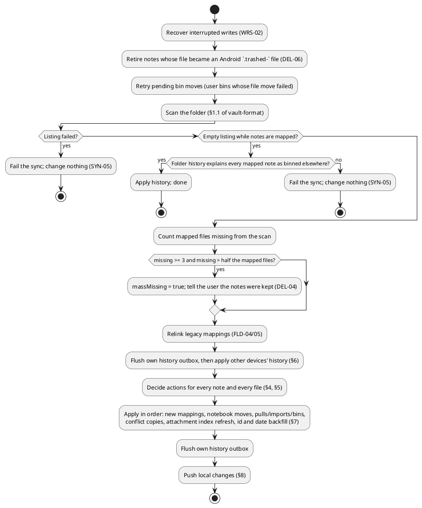

# Sync algorithms (normative)

How one device turns "the notes folder as it is now" and "the notes this device knows" into actions, without losing
data and without disagreeing with other devices. Byte formats are in [vault-format.md](vault-format.md); the rules a
user can observe are the requirements ([SYN](../requirements/sync.md), [IDN](../requirements/identity.md),
[DEL](../requirements/deletion-and-bin.md), [CON](../requirements/conflicts.md), [HST](../requirements/history.md)).

Terms:
- **file**: a note file found by the scan (path, text, modification time in seconds).
- **note**: a note in this device's index (database). A note may be **mapped** to a file.
- **mapping state** (per mapped note, device-local): `baselineHash` (canonical hash at the last agreement),
  `baselineRawHash` (SHA-256 of the file bytes at that time), `preservedYaml` (foreign front matter at that time),
  `vaultAttachmentPaths`, `noteUid` (the file's `allnotes-id`), `missingScanCount`, `userBinned`, `trashedPath`,
  `binnedVaultPath`, `pendingVaultDelete`, `conflictRemoteHash`, `conflictCopyPath`. See
  [data-model.md](data-model.md#mapping-state).

## 1. Deterministic values — MUST match

### 1.1 Content hash
`hash(text) = lowercase hex SHA-256 of the UTF-8 bytes of text`.

### 1.2 Canonical hash of a note (FMT-08)
`canonical(note, path, notebookName, preservedYaml)` =
`hash(render(note at path))` where `render` is [vault-format §4.7](vault-format.md#47-writing-the-block--must-match)
with these differences:
- **no `allnotes-id` line** (so assigning an id never looks like an edit);
- `notebook` is always written (`""` without a notebook);
- the foreign part is `preservedYaml` from the baseline (not the current file);
- no verbatim known keys (the generated form is hashed);
- the note's vault attachments that the body does not link are appended as links (§6.3), so membership is part of it.

`canonicalOfFile(file, note)` is the canonical hash of the note *as the file describes it*: parse the file, build the
note from it (keeping device-local fields from `note`), take tags and reminders from the file, use the file's
`notebook` (or the note's notebook when blank) and the file's own foreign YAML.

Because quoting, leading blank lines, trailing whitespace and key order all disappear in `render`, those differences
never look like changes.

### 1.3 Derived note id (IDN-04, FMT-09)
`derivedId(path, created) = UUIDv3(utf8("allnotes:" + path + ":" + (created ?: "")))`
- `UUIDv3` is the name-based UUID with **no namespace**: MD5 of the bytes; set the version nibble to 3 and the variant
  to IETF (`10xx`); format lowercase with hyphens. (This is Java's `UUID.nameUUIDFromBytes`.)
- `path` is the normalized relative path of the file; `created` is the file's own front-matter `created` in epoch
  seconds **before** the write, or empty when absent or unreadable.

A brand-new note that the app creates (no file at the target and no mapping) gets a random UUIDv4 instead; every other
case uses `derivedId`, so two devices that add an id to the same file independently write the same bytes.

### 1.4 Shared-id owner (IDN-05)
When several mapped files carry the same id, exactly one keeps it. Order the candidates by:
1. files with a `created` before files without;
2. smaller `created`;
3. smaller file modification time (a copy made later is newer); unknown counts as largest;
4. smaller normalized path (plain string order).
The first keeps the id. Every other file gets `derivedId(its path, its created)` written with the single-line edit
(vault-format §5). Device-local note numbers are never used, so all devices pick the same owner.

## 2. The sync cycle

Only one sync runs at a time per folder. Work queued for one folder is never applied to another (Article 2.6).

## 3. Scan guards: uncertainty means keep

| Situation | Decision |
|---|---|
| The listing failed or was partial | No result: the sync fails and nothing changes. |
| The listing is empty while notes are mapped | The sync fails, unless the folder history explains every mapped note (each has a bin applicable here). |
| A mapped file is missing from one complete scan | Keep the note; `missingScanCount += 1`. |
| The same file is missing from the next complete scan too (`missingScanCount` reaches 2) | Bin the note **without** marking it a user bin; the file is not touched (DEL-03). |
| At least 3 mapped files are missing and they are more than half of the mapped files | Keep all of them without counting (DEL-04), and tell the user. |
| A file is quarantined (an interrupted write could not be completed) | It counts as present; its note is left out of this pass. |
| A mapped file reappears | Reset `missingScanCount`; a missing-file bin is restored (DEL-05). |

## 4. Matching files to notes (IDN-03, IDN-05)

For every live mapped note, in this order (each file can be claimed once):
1. **Path**: the file at the mapping's path.
2. **Id**: a file whose `allnotes-id` equals the mapping's `noteUid`. If several unclaimed files carry it, the one
   with the newest modification time is the note (a move); the rest are copies.
3. **Body**: for a mapping without `noteUid` only — a file without an id whose trimmed body hash equals the note's
   trimmed body hash, when exactly one file and exactly one note share that hash. A blank body never matches.

A match at a different path is a **move**: the mapping follows the file and the note's notebook follows the folder.
Unmatched files are imported (§5), except new paths of moves.

Unmapped notes (never exported, or after a folder change) are linked to an existing file instead of being written
again when the file at the note's would-be path, or any unclaimed file, has the same title (case-insensitive) and the
same trimmed body (FLD-03). An unmatched file is linked to an unmapped note on the same rule before it is imported as
new.

## 5. Decision table for a matched note (SYN-06, SYN-07, CON-01, CON-03)

Let `B = baselineHash`, `L = canonical(note, oldPath, notebook, preservedYaml)` (hashed at the path the baseline was
taken at, so a remote move alone is not a local change) and `R = canonicalOfFile(file, note)`.

| Condition (first match wins) | Action |
|---|---|
| `B ≠ ∅` and `L ≠ B` and `R ≠ B` and `R ≠ L` | **Conflict**, unless `conflictRemoteHash == R` (already recorded). The other version is saved as a conflict copy; the note keeps the app's text and is pushed. |
| Locally dirty (`L ≠ B`, or attachments added but not yet copied, or attachment set ≠ baseline set) and content dirty and (`note.modified ≥ file.mtime` or `R == B`) | **Push** the note. |
| Only the attachment set changed and `R == B` | **Push**. |
| Only the attachment set changed and `L == B` (file changed) | **Pull**. |
| Not dirty and `B ≠ ∅` and `R ≠ B` | **Pull** the file into the note. |
| No baseline (legacy row) | Compare modification times (difference > 1 s): newer side wins. |
| Otherwise | Nothing. |

A **pull** imports title, body (or tasks), flags, colour, tags, reminders, notebook (from the folder) and dates from
the file; keeps device-local fields; and stores a new baseline from the file. A pull is skipped when the note changed
since the decision was made (stale pull).

**Conflict at push time** (CON-01): before writing, the app re-reads the file. If its raw hash differs from
`baselineRawHash` and its trimmed body differs from the note's trimmed body, a conflict copy of the disk version is
written first, then the note is written.

**Conflict copy** (CON-02): the other version's exact text with only its `allnotes-id` replaced by
`derivedId(copyPath, its created)`, at the conflict-copy name (vault-format §2.5). Copies are ordinary notes and are
listed in Settings → Sync conflicts.

## 6. Folder history: apply and fold

History is applied after this device's own pending events are written to its log (so the latest action of this user
is in the merged order) and before any decision in §4–§5.

### 6.1 Notes (HST-09, HST-12)
For each note id, take the **last** `note.bin` / `note.restore` / `note.purge` in merged order. Skip events written by
this device and events that are not applicable (vault-format §8.4).

| Latest op | Note here | Decision |
|---|---|---|
| `note.bin` | live, and `path` is still in the scan | Wait (the file move has not arrived). |
| `note.bin` | live, and the note's own current path is in the scan (renamed here) | Keep; show a mismatch "Renamed or moved here; kept". |
| `note.bin` | live, and edited here since the baseline | Keep; mismatch "Edited here; kept". |
| `note.bin` | live, otherwise | Bin the note here as a user bin, pointing at `to`. |
| `note.bin` | unknown id, `path` not in the scan, `to` present | Import the note straight into the bin from the `.trash/` file. |
| `note.restore` | binned, this device's own bin move still pending | Ignore (the local bin is newer). |
| `note.restore` | binned, and `path` is in the scan | Restore. |
| `note.restore` | binned, `path` not yet in the scan | Wait. |
| `note.purge` | binned | Permanently delete here. |
| `note.purge` | live | Keep; mismatch "Restored here; kept". |
| any | event has no `path` where one is needed | Keep; mismatch "No folder path in this event; kept". |

### 6.2 Notebooks and tags (HST-10)
Fold all applicable events in merged order into a target per name (`present` / `absent`), separately for notebooks and
tags:
- `create(name)` → `present` (a notebook name that is not a valid segment is ignored);
- `delete(name)` → `absent`;
- `rename(name → to)`: if `name` is already `absent`, `to` becomes `absent` too (the rename lost a race); otherwise
  `name` → `absent`, `to` → `present`. A notebook rename to an invalid name is ignored.
Then: a `present` name with no row is created; an `absent` name's rows are deleted **only when no note uses them**.
Rows are never renamed in place — a used notebook or tag changes name when its notes' files bring the new name.

### 6.3 Device identity (HST-02, HST-05)
Before writing, a device reads the logs. Lines under its own id that it did not write (or two different lines with one
`eid`) mean a cloned install: it switches to a new random id, resets its `seq`, and writes `device.reid` with the old
id first. Lines it wrote itself but had not yet committed (a crash after the write) are adopted, not duplicated.

## 7. After the decisions
1. Store new and moved mappings; a moved note's notebook follows its folder.
2. Apply pulls, imports and bins (missing-file bins are not user bins).
3. Write conflict copies.
4. Refresh the attachment index from the files.
5. **Backfill** (IDN-04, FMT-09): for every mapped file that is not about to be pushed, is not quarantined, is valid
   UTF-8 and has no byte-order mark:
   - the id it should carry is its own `allnotes-id`; or the mapping's `noteUid`; or `derivedId(path, created)` when
     it has neither or when another file owns the id (§1.4);
   - missing `created`/`modified` are filled from the note's dates (or the file's modification time when the note is
     new in this pass); a note with unsynced local changes gets no dates here;
   - all changes are made in **one** write using the single-line edits, as a compare-and-swap against the scanned
     bytes (a file changed meanwhile is left for the next sync);
   - the new bytes become the baseline, so the write is not seen as a local edit.

## 8. Push
- **Create**: write the note at its path (vault-format §2.1) with a new id (§1.3), copy its attachments into its asset
  folder, record the baseline.
- **Update**: compute the desired path from title, Markdown flag and notebook. If it differs, move the owned
  attachments, write the new file, then delete the old one (a case-only change is a rename). Check for a concurrent
  edit first (§5). Write through the crash-safe protocol (vault-format §7). Record `note.move` when the path changed.
  Store the new baseline.
- **Bin** (user): move the file into `.trash/` (vault-format §2.6); if the source remains, undo and retry later
  (`pendingVaultDelete`). Record `note.bin`.
- **Restore** (user): move the file back; record `note.restore`.
- **Permanent delete** (user, from the bin): delete the note's `.trash/` file and its owned attachments — never a file
  at the original path, which may now belong to another note. Record `note.purge` only for notes the user binned.

## 9. Triggers (BGD, SYN-02)
A sync runs: when the app comes to the foreground (throttled to once per 2 minutes), on pull-to-refresh, from a
periodic background job (hourly, no network needed), after a folder change notification when the platform offers one
(best effort), and after a backup restore. A note the user changes is pushed on its own (debounced, §8) without a
full scan (SYN-06). See [BGD](../requirements/background.md)
and the open SYN-02 mismatch in [the 2026-11-12 review](../audits/2026-11-12-undocumented-features-review.md).
